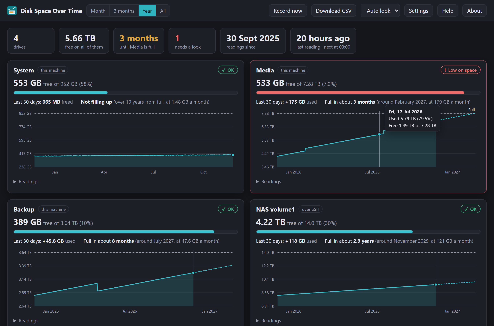
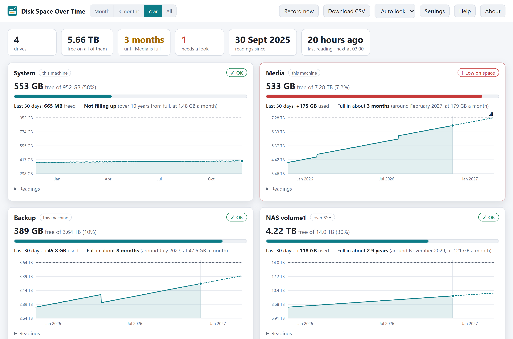
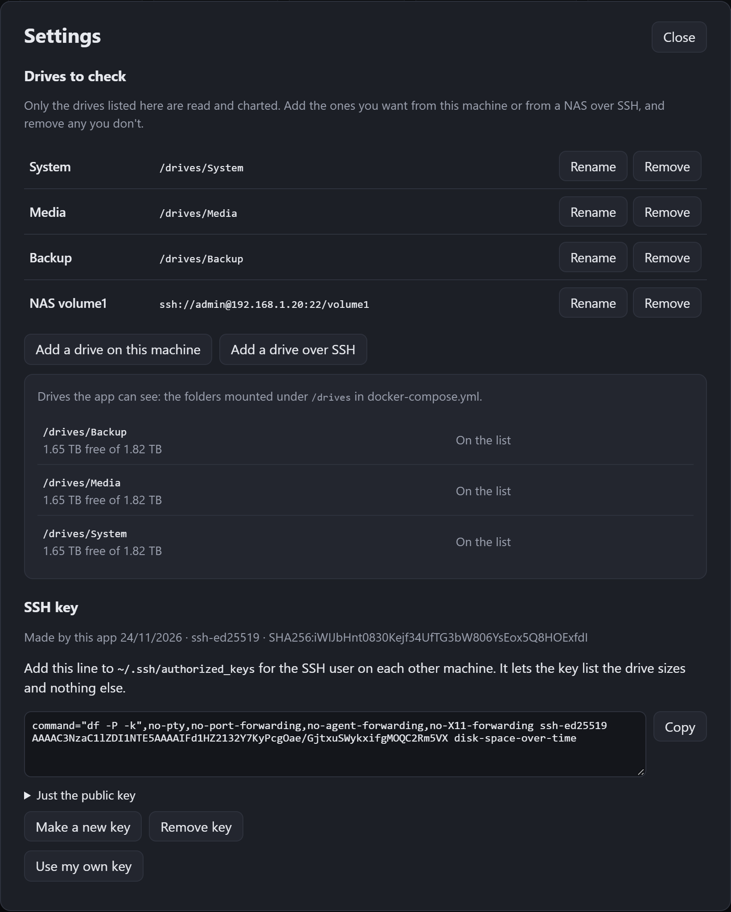

<p align="center">
  
</p>

# Disk Space Over Time

Records the free space on your NAS or PC drives every day and charts it, so you can see when a drive is filling up, run in Docker.


Disk Space Over Time runs on your NAS or your PC, reads how big each of your drives is and how much is free once a day, keeps every reading, and shows a chart per drive with when it will be full at the rate it has been filling. Drives on the machine it runs on are mounted into it read-only; drives on a NAS or another computer are read over SSH with a key it makes for you. It only reads sizes: it never opens, changes or deletes a file.

## ✨ Features

- **A reading every day**: every drive is read at 03:00 (or the time you set) and the first time the app runs. If the machine was off then, the day's reading is made as soon as it's back. **Record now** reads them all at once.
- **When will it be full?** Each drive shows its free space, how much more is used than 30 days ago, and when it will be full at the rate of the last 90 days, such as *Full in about 3 months (around February 2027, at 179 GB a month)*.
- **A chart per drive**: the space used over time, the drive's size as a dashed line, and the trend carried on to the right. Month, 3 months, Year or All; hover (or use the arrow keys) for any day's reading.
- **Marks that stand out**: *Low on space* under 10% free and *Filling up* when a drive will be full within 90 days (both can be changed), with totals for all drives at the top.
- **You choose the drives**: pick which drives to check in Settings, from a NAS or another computer over SSH and from this machine through read-only mounts. A NAS on its own needs no mounts at all. The app makes its own SSH key and shows the line to add to `authorized_keys`, which lets the key run `df` (list the drive sizes) and nothing else. Works with Synology NAS, Linux servers and Raspberry Pis.
- **No false alarms**: a drive that can't be read (an unplugged drive or a sleeping NAS) is tried again every 30 minutes that day, and nothing is recorded for it until it answers, so a gap never looks like an empty drive.
- **Every reading kept**: a year of daily readings for ten drives is well under 1 MB. **Readings** under each chart lists them, and **Download CSV** gives the lot as a spreadsheet that opens right in Excel.
- **Sign-in**: one username and password, a lockout after 10 wrong passwords in 15 minutes.
- Light and dark looks (or as the browser), Help and About, and `GET /healthz` for Docker and uptime monitors.

## 🖼️ Screenshots







## 📋 Requirements

- Docker with Docker Compose v2 (Docker Desktop on Windows, or Docker Engine on Linux or a NAS)
- For drives on other machines: SSH turned on there (see [Reading a NAS over SSH](#reading-a-nas-over-ssh))
- To run without Docker: Node.js 22.12 or later

## 📦 Installation

1. Put `docker-compose.yml` and `.env.example` from this repository in a folder on the Docker host (or clone the repository).
2. Copy `.env.example` to `.env` in the same folder and set `APP_USERNAME`, `APP_PASSWORD`, `SESSION_SECRET` and `TZ` (see Configuration below).
3. Optional: to check drives of the machine it runs on, add them under `volumes` in `docker-compose.yml`, one line each, read-only (remove the `#` from the example line). Skip this if you only want a NAS or other machines, which are read over SSH:

   | Running on | Lines |
   | --- | --- |
   | Windows (Docker Desktop) | `- C:/:/drives/C:ro` and `- D:/:/drives/D:ro` |
   | Linux | `- /:/drives/System:ro` and `- /mnt/data:/drives/Data:ro` |
   | Synology NAS | `- /volume1:/drives/volume1:ro` |

   Any folder on a drive gives that drive's size; the app never reads the files in it. Mounting a drive only makes it available: you pick which drives to check in Settings.
4. Start it from that folder:

   ```
   docker compose up -d
   ```

   This pulls `jason4bury/disk-space-over-time` from Docker Hub. To build the image yourself, run `docker build -t jason4bury/disk-space-over-time .` in this repository first.
5. Open `http://<your-server>:3060`, sign in and open **Settings** to pick the drives to check (any you mounted are already on the list). For a NAS or another computer, see [Reading a NAS over SSH](#reading-a-nas-over-ssh).
6. Each drive gets its first reading straight away, and the charts fill in day by day.

To use a different port on the host, change the first number in `"3060:3060"` in `docker-compose.yml`.

**Updating:** `docker compose pull` then `docker compose up -d`. The readings are kept in the `disk-space-over-time-data` volume.

## 🚀 Usage

- Each drive has a card: free space now, a bar for how full it is, the last 30 days, when it will be full, and the chart.
- **Month**, **3 months**, **Year** and **All** at the top pick how far back the charts go. The chart's left side starts a little below the least space used in that time, so a slowly filling drive still shows its slope; the labels give the real sizes.
- Hover over (or tap) a chart for a day's reading, or click it and use the left and right arrow keys.
- **Readings** under a chart lists them as a table with the change from the reading before.
- **Download CSV** saves every reading of every drive.
- **Settings** picks the drives to check (add, rename, remove) and makes the SSH key. Only the drives on its list are read. `http://<your-server>:3060/#settings` opens it straight away. A removed drive's readings are kept, and come back if you add it again; renaming keeps them too.

## ⚙️ Configuration

You choose which drives to check in **Settings**: drives on other machines over SSH, and any drives of this machine mounted in `docker-compose.yml`. The other settings live in `.env` next to the compose file, which passes them to the container. `.env` is gitignored; `.env.example` shows every setting.

| Setting | Required | What it does |
| --- | --- | --- |
| `APP_USERNAME`, `APP_PASSWORD` | Yes | The sign-in account |
| `SESSION_SECRET` | Yes | Random string of 32+ characters that signs the sign-in cookie and encrypts the saved SSH key. Change it and you'll need to add the key again |
| `TZ` | | Your time zone, such as `Europe/London`, so readings are made at your local time |
| `RECORD_TIME` | | The time every drive is read each day, 24-hour clock (default `03:00`) |
| `KEEP_DAYS` | | Days of readings to keep (default 0, keep them all) |
| `TREND_DAYS` | | Days the filling rate is worked out over (default 90, at least 14) |
| `LOW_PERCENT` | | A drive is *Low on space* under this % free (default 10) |
| `SOON_DAYS` | | A drive is *Filling up* when it will be full within this many days (default 90) |
| `DRIVES` | | The drives to start with, until any are saved in Settings: comma-separated `Name=/drives/folder` or `Name=ssh://user@address:port/mount`. Blank starts with every drive mounted under `/drives` |
| `SSH_FINGERPRINTS` | | Only trust machines whose SSH host key has one of these fingerprints |

The app refuses to start if the sign-in settings are missing or still the example values, and says which one in `docker compose logs disk-space-over-time`.

### How "Full in about" is worked out

A straight line is fitted through the space used over the last `TREND_DAYS` days, and the free space is divided by how fast that line climbs. A drive needs a week of readings first. A drive filling by under 1 GB a month (or 0.1% of its size), or one over ten years from full, shows as *Not filling up*; one that is being cleared out shows as *Emptying*. Big one-off copies (or clear-outs) move the rate for a while, so treat the date as a guide.

### Reading a NAS over SSH

1. In **Settings**, press **Make a key** under SSH key. (Or press **Use my own key** and paste a private key you already use.)
2. Press **Copy** beside the line it shows, and add it on its own line to `~/.ssh/authorized_keys` for the SSH user on the NAS. On a Synology NAS, turn on SSH (Control Panel > Terminal & SNMP) and the user home service (Control Panel > User & Group > Advanced) first.
3. Press **Add a drive over SSH**, fill in the NAS's address, SSH port and user, and press **Show its drives**. Give the one you want a name (such as *NAS*) and press **Add**. On a Synology NAS it's `/volume1`.

**Why the line starts with `command=`.** All the app ever needs is the list of drive sizes, and the `command="df -P -k",no-pty,...` part of the line stops the key doing anything else on that machine, even if someone copied it. If you paste a key you also use yourself, add its plain public key instead, or that key will be limited too.

**Where the key is kept.** In the app's data folder, encrypted with `SESSION_SECRET`. Settings shows only the public half. A key file can also be given with `SSH_KEY` (and `SSH_KEY_PASSPHRASE`); it's used when no key has been added in Settings.

**Running it on the NAS instead.** The app runs on a NAS's own Docker too: mount `/volume1:/drives/volume1:ro` and its drives are read directly, with no SSH. Windows PCs don't usually have SSH turned on, so to see a PC and a NAS together, run the app on the PC and read the NAS over SSH.

### Putting it on the internet

- Keep it on your home network if you can. For access from outside, a WireGuard or Tailscale tunnel is safest.
- Otherwise put it behind a reverse proxy with HTTPS (Nginx Proxy Manager, Caddy, Traefik, Synology) rather than forwarding the port from your router, and use a strong `APP_PASSWORD`. The sign-in cookie is marked secure automatically when the proxy forwards HTTPS.

### Running without Docker

Install Node.js 22.12+, run `npm ci --omit=dev --omit=optional`, set the settings in `.env` and start it with `npm start`. Give the drives with `DRIVES`, such as `DRIVES=C=C:/, D=D:/`. Readings and settings are kept in `./data` unless `DATA_DIR` is set, and it listens on port 3060 unless `PORT` is set.

### Project layout

```
server/
  index.js     Express app, start-up checks, security headers, /api/drives, CSV
  auth.js      sign-in, sign-out and lockout
  drives.js    reads each drive: statfs for mounted folders, df over SSH for other machines
  recorder.js  the daily reading, and trying again for drives that didn't answer
  stats.js     the change over 30 days and when each drive will be full
  store.js     the drives, the readings and the encrypted SSH key, kept in DATA_DIR
  version.js   shows package.json's version as v1.00
public/        the page (index.html, login.html, css/, js/app.js, js/settings.js, icons)
assets/        icon and README image
docs/          screenshots
```

Run `npm run lint` (ESLint) before committing.

## 📝 Changelog

See [CHANGELOG.md](CHANGELOG.md).

## 📄 Licence

MIT, see [LICENSE](LICENSE). Copyright (c) 2026 Jason Rhodes.

Created by Jason Rhodes, built with Claude (Anthropic).
